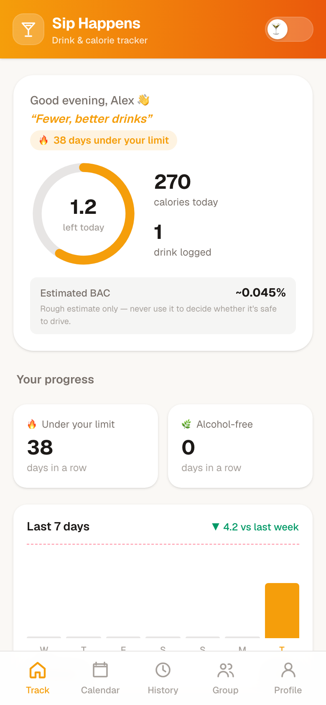
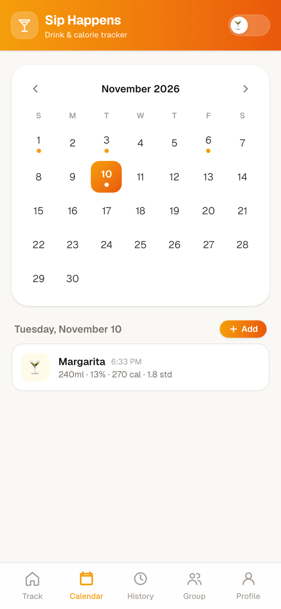
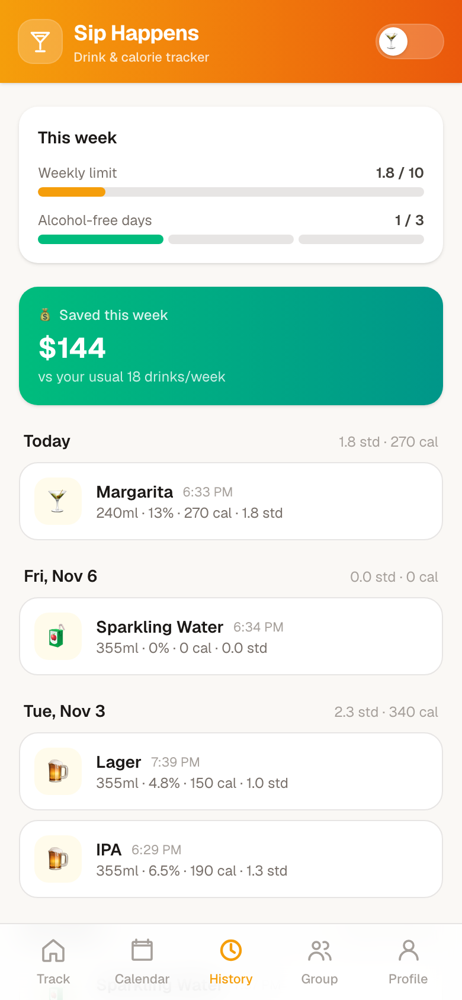
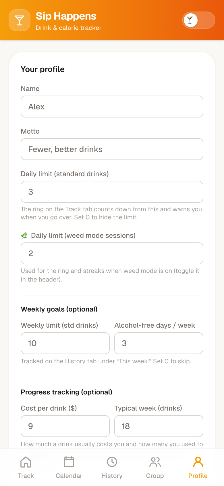
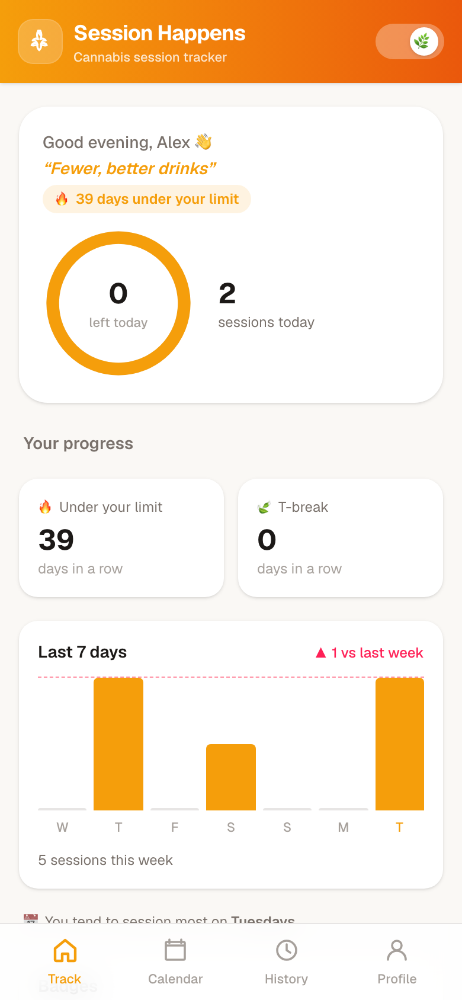

# Sip Happens

A mobile-first drink and calorie tracker. Log a drink from a photo or by hand, see how your day and week stack up against your own limits, and keep a streak going. It also has a cannabis session mode, group challenges, and installs as a PWA.

**Live app:** https://drink-tracker-lime.vercel.app

<p>
  
  
  
  
  
</p>

<sub>Screenshots use demo data.</sub>

## Features

- **Photo logging**: snap a drink and Gemini estimates its type, volume, ABV and calories. You can edit before saving.
- **Daily and weekly limits**: progress ring, standard-drink counts, rough BAC estimate, and under-limit and alcohol-free streaks.
- **Calendar and history**: browse any day, backdate entries, see weekly trends and money saved against your usual baseline.
- **Badges and insights**: streak badges and patterns such as the day you drink most.
- **Session mode**: a separate cannabis tracker with its own theme, limits and t-break streak.
- **Groups and Abstain August**: share progress with friends and take on the dry-month challenge (Supabase), with optional push reminders.
- **Local first**: your data lives in the browser's localStorage, with backup and restore from the profile page.

## Stack

Next.js 16 (App Router), React 19, Tailwind CSS 4, Supabase (groups), Google Gemini (photo analysis), web-push.

## Getting started

```bash
npm install
cp .env.local.example .env.local   # fill in your keys
npm run dev
```

Open http://localhost:3000. Only `GEMINI_API_KEY` is needed for photo logging. Supabase and VAPID keys are only needed for groups and push notifications. See `.env.local.example`.

## Deploy

Deploys on Vercel. Add the same environment variables in the project settings.
